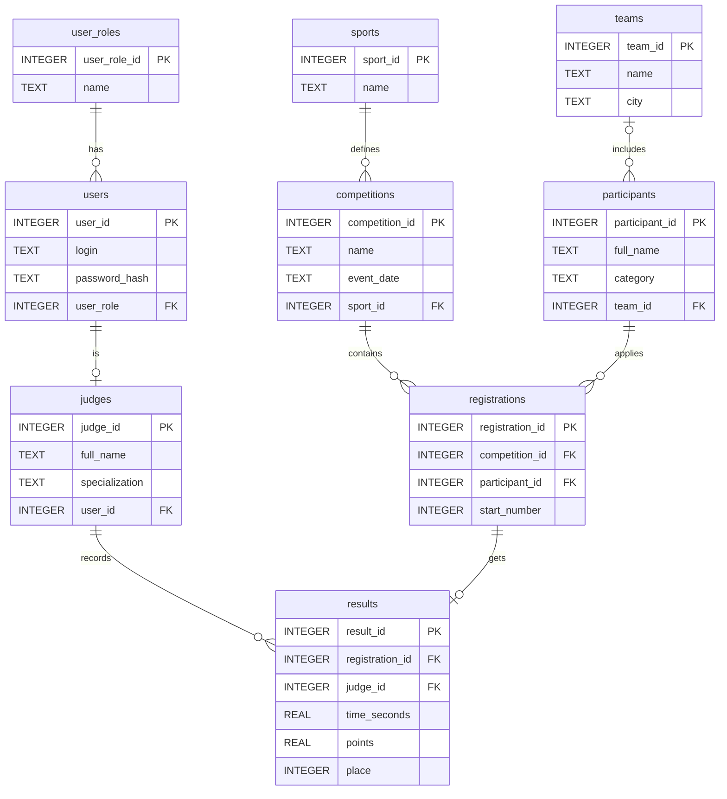

# Система «Учёт результатов соревнований»

## Описание проекта

Проект посвящён информационной системе **«Учёт результатов соревнований»**.

Система предназначена для регистрации спортивных (или иных) соревнований, участников и результатов выступлений, а также для формирования итоговых протоколов и рейтингов.

В системе предполагается хранение следующих данных:

- соревнования: название, дата, вид спорта/дисциплина, категория;
- участники: ФИО, команда;
- судьи: ФИО, специализация;
- результаты выступлений: показатель (время, очки или занятое место).

## Цели системы

- автоматизировать сбор и хранение результатов соревнований;
- исключить ошибки ручного подсчёта мест и очков;
- ускорить формирование итоговых протоколов и отчётов;
- обеспечить участникам и зрителям быстрый доступ к результатам.

## Пользователи системы

| Пользователь | Возможности |
|---|---|
| Администратор | Создание соревнований, регистрация участников, управление справочниками, формирование отчётов |
| Судья | Внесение и редактирование результатов выступлений |
| Пользователь | Просмотр протоколов и результатов без права редактирования |

## Основные функции

1. Добавление и редактирование карточки соревнования.
2. Регистрация участников на соревнование.
3. Внесение результата выступления с проверкой корректности формата.
4. Автоматический пересчёт рейтинга и распределение мест.
5. Формирование и просмотр итогового протокола.
6. Экспорт отчётов в форматах CSV / JSON / документ.

## Архитектура

Проект предусматривает трёхуровневую логическую архитектуру:

1. **Слой хранения данных** — реляционная СУБД с таблицами «Соревнования», «Участники», «Результаты» и связанными данными.
2. **Слой бизнес-логики** — обработка ввода, проверка корректности, расчёт итогов и распределение мест.
3. **Слой представления** — консольный или графический интерфейс для ввода данных и просмотра отчётов.

Для лабораторной работы демонстрационная программа намеренно оставлена минимальной: она выводит `Hello, World!`. Это позволяет проверить настройку среды разработки и корректность запуска проекта.

## Запуск программы

Требуется установленный Python 3.

В терминале VS Code выполните:

```bash
python main.py
```

Результат:

```text
Hello, World!
```

## Структура проекта

```text
competitions-project/
├── .gitignore
├── README.md
├── main.py
└── docs/
    └── diagrams/
        ├── competitions_usecase.puml
        └── competitions_activity.puml
```

## Диаграммы

В каталоге `docs/diagrams/` находятся исходники диаграмм PlantUML:

- `competitions_usecase.puml` — Use Case диаграмма;
- `competitions_activity.puml` — диаграмма процесса внесения и обработки результата.

### Основной процесс

Упрощённая последовательность обработки результата:

1. Выбрать соревнование и участника.
2. Ввести показатель: время, очки или место.
3. Проверить корректность формата.
4. При ошибке повторить ввод.
5. Сохранить результат.
6. Пересчитать рейтинг и распределение мест.
7. Проверить, все ли результаты внесены.
8. Сформировать итоговый протокол.
9. Экспортировать отчёт в CSV / JSON.

## Git

Проект предназначен для работы с Git и GitHub.

Основные операции:

```bash
git init
git add .
git commit -m "Первый коммит"
git branch -M main
git remote add origin <ссылка-на-GitHub-репозиторий>
git push -u origin main
```

## Автор

Лабораторная работа №2 по теме «Документирование программных проектов: GitHub, Markdown и PlantUML».
## Лабораторная работа №3. Проектирование и реализация базы данных

### ER-диаграмма
Та же диаграмма в Mermaid:



### Таблицы

| Таблица | Назначение |
|---|---|
| `user_roles` | Справочник ролей: Administrator, Judge, Viewer |
| `users` | Учётные записи (логин, хеш пароля, роль) |
| `judges` | Судьи: ФИО, специализация; связь 1:1 с `users` |
| `sports` | Виды спорта / дисциплины |
| `teams` | Команды |
| `competitions` | Соревнования: название, дата, вид спорта |
| `participants` | Участники: ФИО, категория, команда |
| `registrations` | Регистрация участника на соревнование (связь M:N), стартовый номер |
| `results` | Результат выступления: время, очки, место; связь 1:1 с `registrations` |

### Связи

- 1:N: `user_roles` → `users`, `sports` → `competitions`, `teams` → `participants`, `judges` → `results`.
- 1:1: `users` → `judges`, `registrations` → `results`.
- M:N: `competitions` ↔ `participants` через `registrations`.

### Создание базы данных

```bash
python db/init_db.py
# или вручную:
sqlite3 db/competitions.db < db/schema.sql
sqlite3 db/competitions.db ".tables"
sqlite3 db/competitions.db "SELECT * FROM results;"
```

Файл `db/schema.sql` удаляет старые таблицы, создаёт новые (сначала справочники,
затем зависимые таблицы) и добавляет тестовые записи.
